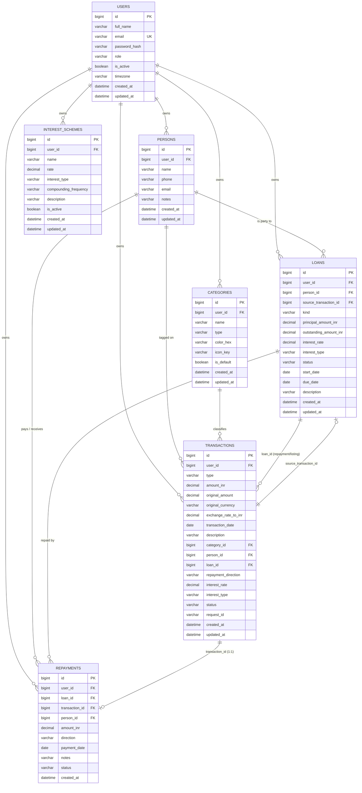

# Database Design

## 1. Overview

The system uses a polyglot persistence split:

| Store | Data | Role |
| --- | --- | --- |
| MySQL 8.x (InnoDB) | users, persons, categories, interest schemes, loans, transactions, repayments | System of record; all balances and financial invariants |
| MongoDB 6/7 | `voice_commands`, `audit_logs`, `application_events`, `exchange_rates` | Confirmed voice metadata, audit trail, operational events and short-lived FX cache |

MySQL owns anything that must be correct after a crash. MongoDB documents are
supplementary: event/voice write failures are logged and ignored, and a cache
miss simply triggers a provider lookup.

## 2. Entity-relationship diagram



Cardinality notes:

- `transactions.loan_id` is nullable: only lending, borrowing and repayment rows
  reference a loan.
- `loans.source_transaction_id` points back to the transaction that created the loan.
  This pair is circular, so one side is added with `ALTER TABLE` in the migration.
- `repayments.transaction_id` is unique, enforcing one repayment record per ledger
  transaction.
- `users.email` and `(user_id, request_id)` are unique.

## 3. Tables and constraints

### `users`

| Column | Type | Constraints |
| --- | --- | --- |
| `id` | BIGINT | PK, auto-increment |
| `full_name` | VARCHAR(120) | NOT NULL |
| `email` | VARCHAR(255) | NOT NULL, UNIQUE (`ix_users_email`) |
| `password_hash` | VARCHAR(255) | NOT NULL, Argon2id |
| `role` | VARCHAR(20) | NOT NULL, default `user`; values `user`, `admin` |
| `is_active` | BOOLEAN | NOT NULL, default true |
| `timezone` | VARCHAR(64) | NOT NULL, default `Asia/Kolkata` |
| `created_at`, `updated_at` | DATETIME | NOT NULL, UTC |

### `persons`

Unique `(user_id, name)` prevents duplicate people per owner; `user_id` cascades on
user deletion. `transactions.person_id` uses `SET NULL` so ledger history survives a
person deletion, while `loans.person_id` and `repayments.person_id` use `RESTRICT`
because open financial obligations must not lose their counterparty.

### `categories`

Unique `(user_id, name, type)`. Categories are typed (`income`, `expense`, ...) to
avoid attaching an income category to an expense. Transactions keep history when a
category is deleted (`SET NULL`).

### `interest_schemes`

Reusable interest presets (`rate`, `interest_type` in `simple`, `compound`, `flat`,
and `compounding_frequency` in `none`, `daily`, `monthly`, `quarterly`,
`half_yearly`, `yearly`). Loans copy the rate and interest type they use; later
scheme edits do not mutate existing loans.

### `loans`

| Column | Notes |
| --- | --- |
| `kind` | `lent` or `borrowed` |
| `principal_amount_inr` | `DECIMAL(15,2)` |
| `outstanding_amount_inr` | `DECIMAL(15,2)`, updated atomically with repayments |
| `interest_rate` | `DECIMAL(6,3)` percent, default 0 |
| `interest_type` | `simple`, `compound`, `flat` |
| `status` | `open`, `closed` |
| `source_transaction_id` | UNIQUE, FK to the creating transaction, `SET NULL` |
| `due_date` | optional DATE used for upcoming/overdue views |

### `transactions`

The central ledger. Every money movement is one row.

| Column | Notes |
| --- | --- |
| `type` | `income`, `expense`, `savings`, `lending`, `borrowing`, `repayment` |
| `amount_inr` | `DECIMAL(15,2)`, canonical value |
| `original_amount`, `original_currency` | populated only for non-INR input |
| `exchange_rate_to_inr` | `DECIMAL(18,8)`, rate actually used |
| `transaction_date` | user-intended DATE (not an audit timestamp) |
| `category_id`, `person_id`, `loan_id` | nullable FKs, `SET NULL` |
| `repayment_direction` | `received` or `paid`, only for repayments |
| `status` | `completed` or `reversed`; aggregates only count `completed` |
| `request_id` | client UUID, UNIQUE with `user_id` |
| `created_at`, `updated_at` | server UTC timestamps |

### `repayments`

One row per repayment, linked 1:1 to its transaction (`UNIQUE(transaction_id)`) and
many-to-one to a loan. `direction` must agree with the loan kind:
`received` for `lent`, `paid` for `borrowed`.

## 4. Circular foreign key

`loans.source_transaction_id` references `transactions.id`, while
`transactions.loan_id` references `loans.id`. MySQL cannot create both tables with
inline foreign keys in one pass. The migration therefore:

1. creates `loans` without the `source_transaction_id` FK,
2. creates `transactions` with `loan_id` FK,
3. runs `ALTER TABLE loans ADD CONSTRAINT fk_loans_source_transaction ...`,
4. creates `repayments`.

SQLAlchemy expresses the same cycle with `use_alter=True`. The offline migration SQL
was checked with `alembic upgrade head --sql` to confirm the alter statement is
emitted after both tables.

## 5. Indexes

| Index | Purpose |
| --- | --- |
| `UNIQUE(users.email)` | login lookup, duplicate prevention |
| `UNIQUE(persons.user_id, name)` | no duplicate person per user |
| `UNIQUE(categories.user_id, name, type)` | no duplicate category per type |
| `UNIQUE(loans.source_transaction_id)` | one loan per creating transaction |
| `UNIQUE(transactions.user_id, request_id)` | idempotency guard |
| `UNIQUE(repayments.transaction_id)` | 1:1 transaction/repayment |
| `(user_id, transaction_date, id)` | paged history, calendar, dashboard |
| `(user_id, type)` | typed history and aggregates |
| `(user_id, category_id)` | category breakdown |
| `(user_id, person_id)` | person ledger and net position |
| `(user_id, loan_id)` | repayments and loan context joins |
| `transactions.request_id` | idempotency lookup |
| `loans.(user_id, status)`, `(user_id, kind, status)` | dashboard and loan lists |
| `repayments.(user_id, payment_date)`, `(loan_id, payment_date)` | repayment history |
| `categories.(user_id, type)` | directory filters |

Every user-facing query filters on `user_id` first, so composite indexes lead with
`user_id`. Single-column indexes are retained for foreign-key checks and admin joins.

## 6. Normalization

The schema is in third normal form for stored facts:

- **1NF:** all columns are atomic; no repeating groups. Multi-valued concepts such as
  a person's loans are separate rows, not arrays.
- **2NF:** tables use single-column surrogate keys, so no non-key attribute depends on
  part of a composite key.
- **3NF:** descriptive attributes depend only on the key. For example, a loan stores
  `person_id`, not the person's name; category names live only in `categories`.

Deliberate denormalization/derivation:

1. **`loans.outstanding_amount_inr` is stored.** It is a lifecycle state updated in
   the same transaction as each repayment, not a copy of independently editable
   data. This makes open-loan listing and repayment validation cheap and lets a row
   lock protect the invariant.
2. **Balances are not stored on `users`.** They are computed by aggregation over
   transactions. This removes an update hotspot and guarantees the ledger is the
   single source of truth.
3. **`transactions.original_amount` and `exchange_rate_to_inr` are historical
   facts.** They intentionally duplicate information derivable from a rate table so
   that later rate changes cannot rewrite history.

## 7. Transactions and concurrency

### Balance formula

```sql
SELECT
  SUM(CASE
        WHEN type = 'income' THEN amount_inr
        WHEN type = 'borrowing' THEN amount_inr
        WHEN type = 'repayment' AND repayment_direction = 'received' THEN amount_inr
        ELSE -amount_inr
      END) AS available_balance
FROM transactions
WHERE user_id = :user_id AND status = 'completed';
```

### Write protocol

```
START TRANSACTION
  SELECT ... FROM users WHERE id = :user_id FOR UPDATE
  SELECT ... FROM transactions WHERE user_id = :uid AND request_id = :rid
  IF found: COMMIT and replay stored response
  compute balance / load loan
  validate business rules
  INSERT transaction
  INSERT/UPDATE loan and repayment
COMMIT
```

The user-row lock serializes concurrent writes for the same user, so two expenses
cannot both pass a stale balance check. Different users do not block each other.
`UNIQUE(user_id, request_id)` is a second line of defense: if a duplicate insert
slips past the pre-check, the `IntegrityError` triggers rollback, reload of the
original row and an idempotent replay.

### Isolation

MySQL's default `REPEATABLE READ` is sufficient because all balance-changing writes
lock the same user row. Read endpoints use plain consistent reads. Aggregates ignore
`reversed` rows so a future reversal feature cannot silently change historical
totals without a status update.

### Invariants enforced in code and schema

| Invariant | Enforcement |
| --- | --- |
| Amount > 0 and max 15 digits / 2 decimals | Pydantic + business rules + `DECIMAL(15,2)` |
| Non-negative available balance for outflows | service check under lock |
| Unique request per user | unique key + replay logic |
| Repayment ≤ outstanding | service check under lock |
| Direction matches loan kind | business rules |
| One repayment per transaction | unique key |
| No orphan loan/repayment counterparty | `RESTRICT` foreign keys |

## 8. Views

`sql/schema/002_views.sql` defines five reporting views:

- `v_user_balances` computes income, expenses, savings, lent, borrowed, repayments
  received/paid and the available balance per user.
- `v_open_loans` joins `loans` and `persons`, and derives urgency as `overdue`,
  `due_soon` (within 30 days) or `on_track`.
- `income`, `expenses` and `savings` are typed, read-only projections over
  `transactions`. They give simple relations for demonstrations without creating
  duplicated subtype tables or update anomalies.

Views keep reporting SQL declarative and give the DBMS report reusable, explainable
queries.

## 9. SQL features demonstrated

`sql/demo_queries/` contains 12 scripts covering:

- conditional aggregation with `CASE`,
- multi-table inner/`LEFT JOIN` with `COALESCE`,
- date grouping with `DATE_FORMAT` and month-to-date filters,
- window functions (`SUM(...) OVER ()`, `RANK() OVER (...)`),
- common table expressions and correlated subqueries,
- `EXPLAIN ANALYZE` for the paged history query,
- a duplicate-request audit query using `GROUP BY ... HAVING COUNT(*) > 1`,
- lending/borrowing positions, repayment audits and calendar aggregates,
- outer joins, `EXISTS`, `UNION ALL` and set operations.

See `docs/database/README.md` for the file-to-feature map.

## 10. MongoDB collections

### `audit_logs`

```json
{
  "event_type": "transaction_created",
  "user_id": 2,
  "request_id": "5f1c...",
  "created_at": "2026-10-20T05:34:21.100Z",
  "ip_address": "192.168.1.20",
  "user_agent": "okhttp/4.12",
  "payload": {
    "transaction_id": 42,
    "transaction_type": "expense",
    "amount_inr": "850.00",
    "voice_text": "spent eight hundred and fifty rupees on groceries",
    "parser_confidence": 0.93
  }
}
```

Indexes: `(user_id, created_at desc)`, `request_id`, `(event_type, created_at desc)`.

### `voice_commands`

```json
{
  "user_id": 2,
  "request_id": "5f1c...",
  "voice_text": "spent eight hundred and fifty rupees on groceries",
  "parser_confidence": 0.93,
  "transaction_id": 42,
  "nlp": {
    "intent": "expense",
    "original_currency": "INR",
    "amount": "850.00",
    "category": "Groceries",
    "person": null,
    "repayment_direction": null
  },
  "source": "android_speech_recognizer",
  "created_at": "2026-10-20T05:34:21.100Z"
}
```

Unique index `(user_id, request_id)` makes voice metadata idempotent. Audio is
never stored.

### `application_events`

Lightweight auth/lifecycle events (`auth_registered`, `auth_login`,
`financial_transaction_committed`, `admin_action_completed`) with `user_id`,
`request_id`, `created_at` and optional payload. Indexed by
`(user_id, created_at desc)`, `(event_type, created_at desc)` and `request_id`.

### `exchange_rates`

```json
{
  "base_currency": "USD",
  "target_currency": "INR",
  "rate": {"$numberDecimal": "83.12000000"},
  "provider": "open.er-api.com",
  "retrieved_at": "2026-10-20T05:00:00Z",
  "valid_until": "2026-10-20T06:00:00Z"
}
```

Indexes: unique `(base_currency, target_currency)` for the current cache entry,
plus `(base_currency, target_currency, retrieved_at desc)` and
`(base_currency, target_currency, valid_until desc)` for pruning. Expired
documents are removed by the whitelisted `PRUNE_RATE_CACHE` admin action.

## 11. Backup and recovery

- `CREATE_BACKUP` runs `mysqldump --single-transaction` into `BACKUP_DIR`, producing
  a consistent snapshot without blocking writes.
- MongoDB is not authoritative; voice metadata, audit logs, application events and
  the FX cache can be rebuilt or accepted as lost without affecting balances.
- Recovery procedure: restore the latest SQL dump into MySQL, run
  `alembic upgrade head` to confirm schema version, then restart the API.
- Demo seed and schema DDL allow a clean rebuild from an empty database.

## 12. Data dictionary summary

| Table | Rows grow with | Retention |
| --- | --- | --- |
| `users` | sign-ups | until account deletion (cascades owned data) |
| `persons` | people the user transacts with | deletable unless referenced by loans/repayments |
| `categories` | user-defined labels | deletable; transaction history kept |
| `interest_schemes` | presets | editable; copied into loans |
| `loans` | lending/borrowing entries | closed loans retained for history |
| `transactions` | every money movement | retained (audit/ledger history) |
| `repayments` | every repayment | retained with its loan |
